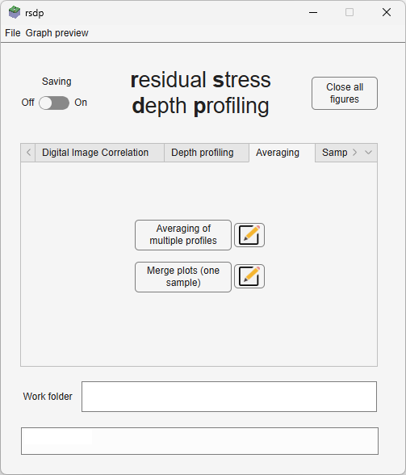
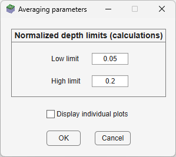
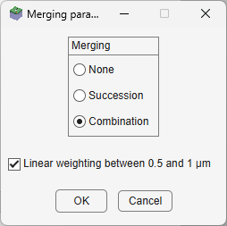

The functions described here were specifically developed for the analysis of multiple depth profiles.

	<figure>
		
		<figcaption> <i> Averaging tab </i> </figcaption>
	</figure>

# Averaging
Averaging takes multiple series in input from the *Pillar directory* path (see [[Data management#Data selection]]) and averages the residual stress values for those series. Standard deviation is also plotted from this averaging as a shaded area around the mean.
The user can also display all the individual plots with the standard deviation on one graph.

	<figure>
		
		<figcaption> <i> Averaging parameters </i> </figcaption>
	</figure>

# Merging
Merging allows to plot multiple averaged profiles for different pillar diameters on the same graph. Multiple merging options have been designed:
- `None` plots the averaged profiles without merging.
- `Succession` plots the first averaged profile until its maximum reached depth, then the second profile from this value to the maximum reach depth of this profile, and so on. Therefore, some data of the second and subsequent profile(s) will not be represented.
- `Combination` calculates an average of both averaged profiles in the area where they overlap.
	- If the `Linear weighting` option is not selected, then a simple average of every residual stress value in the overlap range is calculated. The standard deviation is also averaged.
	- If the `Linear weighting ...` option is selected, then a weighted average is calculated instead. This option is only available for the case where 5 and 10 µm diameter pillars are analyzed. For the 5 µm pillars, the weights value range from 100% at a depth of 0.5 µm to 0% at a depth of 1 µm, while the opposite applies to the 10 µm pillars. This option was added as it was found to create the smoothest transition from one averaged profile to the next. The standard deviations of both profiles is also averaged with the same weights.

	<figure>
		
		<figcaption> <i> Merging parameters </i> </figcaption>
	</figure>

|            Previous section             |                       |        Next section         |
| :-------------------------------------: | --------------------- | :-------------------------: |
| [Depth profiling](Depth%20profiling.md) | [Outline](Outline.md) | [Comparison](Comparison.md) |
