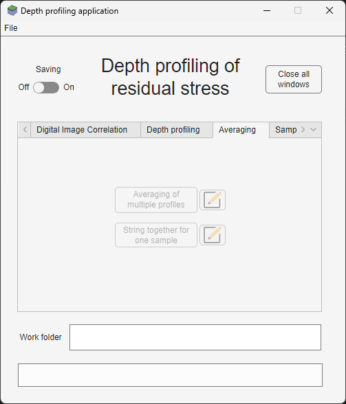
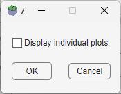

The functions described here were specifically developed for the analysis of multiple series of pillar milling.

Averaging takes multiple series in input from the *Pillar directory* path (see [Data selection](#data-selection)) and averages the values of residual stress. Standard deviation is also plotted from this averaging.

Stringing allows to plot multiple averaged curves one after the other. The *Succession* option plots all data for one pillar diameter, stops at the last numerical value and plots the next pillar diameter. The *Combination* option will average the plots of two pillar diameters.

<table>
    <tr>
        <td style="width:45%"></td>
        <td>
            <figure>
                
                <figcaption> Averaging parameters </figcaption>
            </figure>
        </td>
        <td>
            <figure>
                
                <figcaption> Stringing parameters </figcaption>
            </figure>
        </td>
    </tr>
</table>