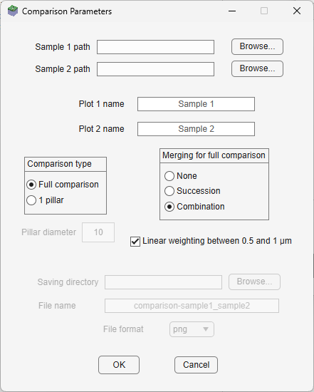

The user can compare two samples over one pillar diameter, or over the full depth profile.

	<table>
		<td>
			

				<figure>
					
					<figcaption><i>Comparison tab</i></figcaption>
				</figure>
			

		</td>
		<td>
			

				<figure>
					
					<figcaption><i>Comparison parameters</i></figcaption>
				</figure>
			

		</td>
	</table>

|                 Previous section                  |                       |      Next section       |
| :-----------------------------------------------: | --------------------- | :---------------------: |
| [Averaging & Merging](Averaging%20&%20Merging.md) | [Outline](Outline.md) | [Examples](Examples.md) |
