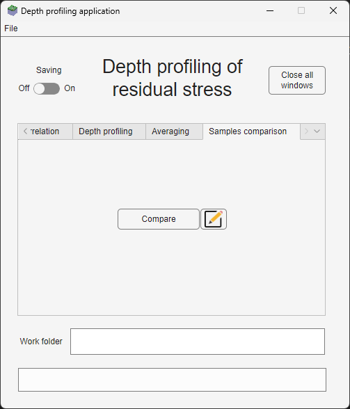
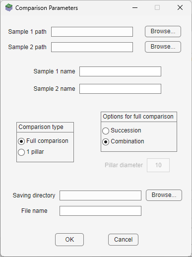

The user can compare two samples for one pillar diameter, or entirely.
<table>
    <tr>
        <td>
            <figure>
                
                <figcaption><i>Comparison tab</i></figcaption>
            </figure>
        </td>
        <td>
            <figure>
                
                <figcaption><i>Comparison parameters</i></figcaption>
            </figure>
        </td>
    </tr>
</table>

