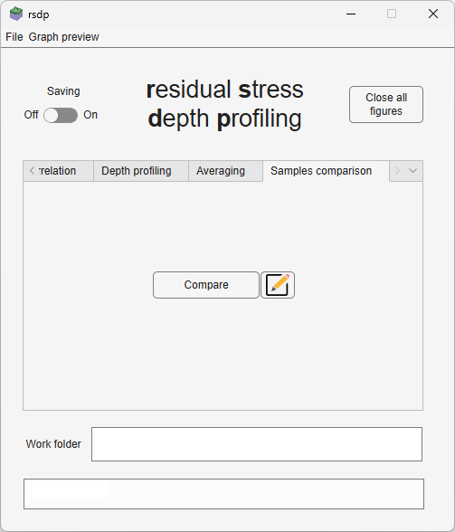

The user can compare two samples over one pillar diameter, or over the full depth profile.

	<table>
		<td>
			<figure>
				
				<figcaption><i>Comparison tab</i></figcaption>
			</figure>
		</td>
		<td>
			<figure>
				
				<figcaption><i>Comparison parameters</i></figcaption>
			</figure>
		</td>
	</table>

| Previous section |             | Next section |
| :--------------: | ----------- | :----------: |
|  [[Averaging & Merging]]   | [[Outline]] | [[Examples]] |
