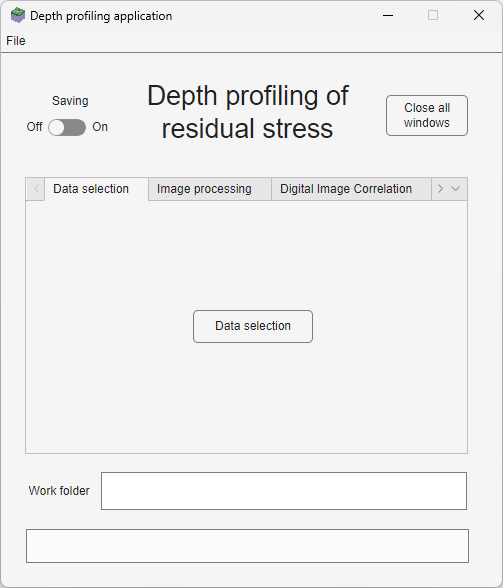
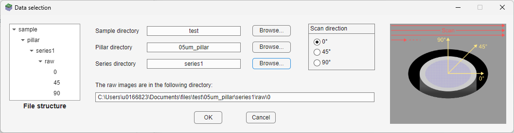
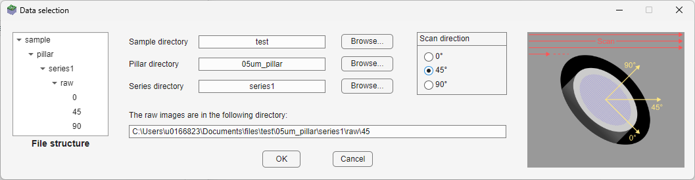
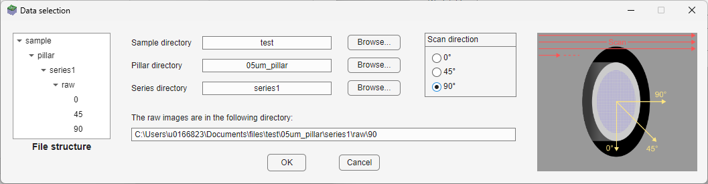
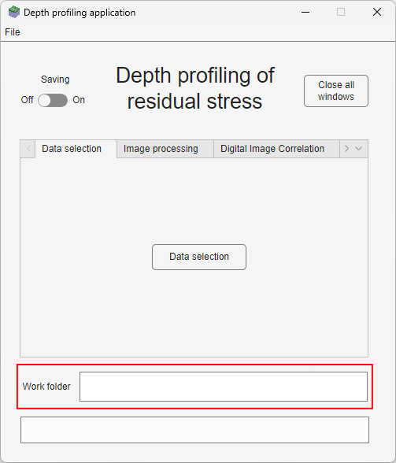

# File structure
The expected general file structure is shown in the following tree:
```
sample
└───pillar
    ├───series1
    |   ├───raw
    |   │   └───0
    |   │   └───45*
    |   │   └───90*
    |   ├───processed**
    |   │   └───0
    |   │   └───45*
    |   │   └───90*
    |   └───results**
    |       └───depth_profiling**
	└───series2
```
\* Optional directories.  
\** These directories will be created automatically after relevant functions have been executed unless they already exist.
# Data selection
The *Data selection* tab allows the user to choose the directory where their data is located.

If a *Series directory* is selected, then the parent directory and its (grand-)parent directory are selected as well, which are named *Pillar directory* and *Sample directory* respectively. This is used for the advanced functions.

The direction of the images can also be chosen, depending on if the user made SEM images of the pillar in the 0°, 45°, and/or 90° scan direction(s) (see [[Image acquisition]] for more details on those orientations).
<center>
    <figure>
        
        <figcaption>
            <i>Data selection tab</i>
        </figcaption>
    </figure>
    <figure>
        
        
        
        <figcaption>
            <i>Data selection window</i>
        </figcaption>
    </figure>
</center>

The application will try to find a raw folder with the images. If the folder does not exist, then the user cannot proceed.
Selecting the data will also change the work folder accordingly.
## Work folder
The 'work folder' shown below is the directory where all modified files are located, such as the analyzed images and the DIC files. It is generally located in `/sample/pillar/series/processed/0` (or `/45` or `/90`) (see [[Image processing]]).
<center>
    <figure>
        
        <figcaption>
            <i>Workfolder field location</i>
        </figcaption>
    </figure>
</center>