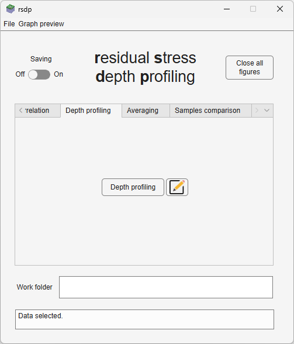
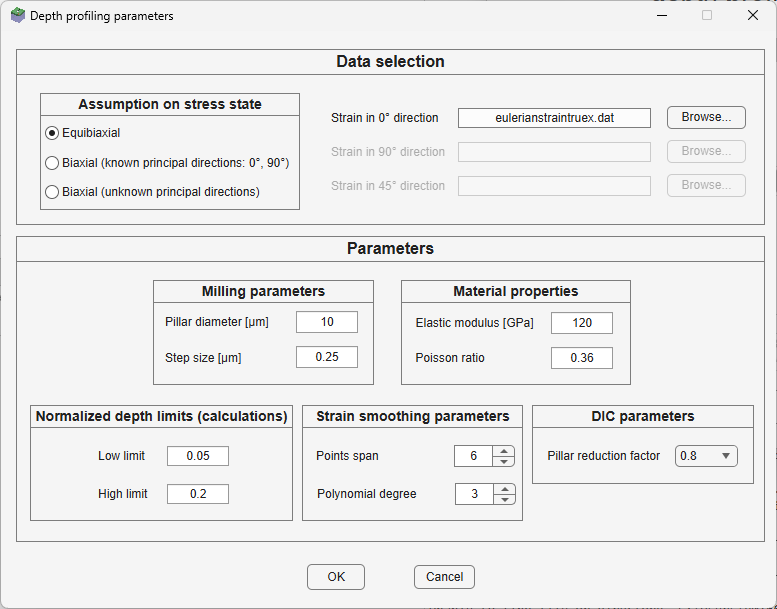

Three depth profiling types can be plotted, depending on the type of stress expected in the material:

|                   Stress state                    |          Strain files required           |                                                  Plotted stress profiles                                                  |
| :-----------------------------------------------: | :--------------------------------------: | :-----------------------------------------------------------------------------------------------------------------------: |
|                    Equibiaxial                    |         One, in the 0° direction         |                                                 One, for the 0° direction                                                 |
| Biaxial (with principal directions at 0° and 90°) |    Two, in the 0° and 90° directions     |                                            Two, for the 0° and 90° directions                                             |
|    Biaxial (with unknown principal directions)    | Three, in the 0°, 90° and 45° directions | Two, for both principal directions. The angle between the 0° direction and the first principal direction is also plotted. |
The user can adjust the following depth profiling parameters:
- Milling parameters (mandatory)
	- Pillar diameter (in µm)
	- Milling step size (in µm)
- Material properties (mandatory)
	- Elastic modulus $E$ (in GPa)
	- Poisson ratio $\nu$ (no unit)
- Strain curve smoothing parameters: The strain curve is smoothed before stress calculations (see [Korsunsky et al., 2018](https://doi.org/10.1016/j.matdes.2018.02.044)). The method used is a moving fitting of a number of points by a polynomial function. Both the number of points (called points span) and polynomial degree are changeable by the user. The depth profiling generates a strain curve and its associated smoothed curve so that the user can test those parameters.
- DIC parameters: The user can change the pillar reduction factor, which is set during the DIC analysis.

	<figure>
		
		<figcaption><i>Depth profiling tab</i></figcaption>
	</figure>
	<figure>
		
		<figcaption><i>Depth profiling parameters window</i></figcaption>
	</figure>

|                       Previous section                        |                       |                   Next section                    |
| :-----------------------------------------------------------: | --------------------- | :-----------------------------------------------: |
| [Digital Image Correlation](Digital%20Image%20Correlation.md) | [Outline](Outline.md) | [Averaging & Merging](Averaging%20&%20Merging.md) |
