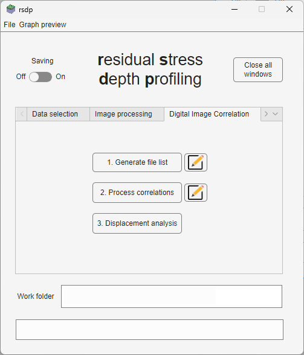
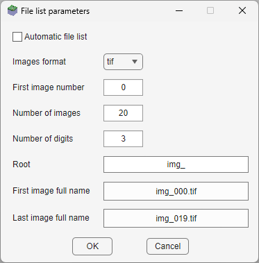
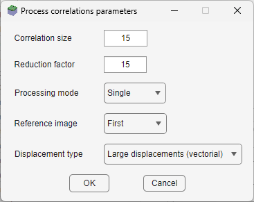
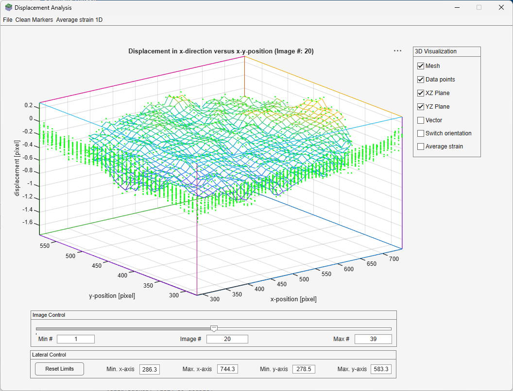

This part of the analysis comprises three steps as in the original DIC application, namely:
1. File list creation
2. Markers definition & Correlations processing
3. Displacement analysis
Those steps were kept here, with less prompts for the user. For example, the file list parameters window shown below makes it easier to create a file list for multiple series in a row by reducing the number of prompts to the user. The same principle applies to the process correlations parameters.

    <figure>
        
        <figcaption><i>DIC tab</i></figcaption>
    </figure>
    <table>
        <tr>
            <td>
                <figure>
                    
                    <figcaption><i>File list parameters</i></figcaption>
                </figure>
            </td>
            <td>
                <figure>
                    
                    <figcaption><i>Process correlation parameters</i></figcaption>
                </figure>
            </td>
        </tr>
    </table>

The displacement analysis application was slightly changed as it was noted that the markers selection controls did not appear before.
<figure>
    
    <figcaption><i>Displacement Analysis application</i></figcaption>
</figure>