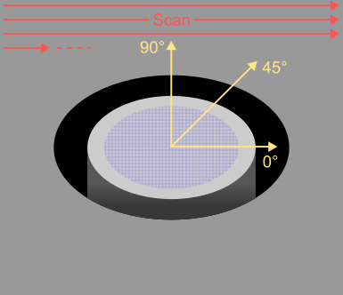

The [FIB-DIC Good practice guide](https://eprintspublications.npl.co.uk/7807/) recommends to take multiple images during after every milling step and to average them, a process which is reflected in the [[Image processing]].

The diagram below represents the three potential scan directions used during image acquisition: 0°, 45° and 90°. Choosing a scan direction depends on the assumed residual stress state (see [[Depth profiling]] for more details on this point).

    <figure>
        
        <figcaption>
            <i>Scan directions</i>
        </figcaption>
    </figure>

| Previous section |             |    Next section     |
| :--------------: | ----------- | :-----------------: |
| [[Introduction]] | [[Outline]] | [[Data management]] |
