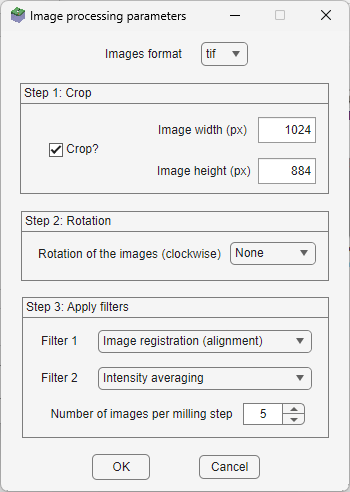

Image processing functions are disabled by default. They take a Fiji path and a series in input (see the Data selection section in [Data management](Data%20management.md)). The former can be selected in `File -> Fiji path`. This path is then automatically selected every time the user opens the application (this will be confirmed in the message box below the work folder field). The user is prompted to select a Fiji path if they have not selected one before.
The image processing will be applied to all of the images of the specified format in the work folder.
# Creating new images
The user can either perform their analysis on the images they acquired or create new ones by rotation. The application will read the name of the `raw` folder and create a `processed` folder accordingly during the image processing step. The folder creation is detailed in the table below.

| Raw images folder | Rotation? | Output folder  |
| :---------------: | :-------: | :------------: |
|      `raw/0`      |    No     | `processed/0`  |
|      `raw/0`      |    45°    | `processed/45` |
|      `raw/0`      |    90°    | `processed/90` |
|     `raw/45`      |    No     | `processed/45` |
|     `raw/90`      |    No     | `processed/90` |
The option of rotating images was added in case the user did not change the scan direction during the image acquisition, but still desires a biaxial analysis of stresses.
# Operations & Filters
In the *Image processing* tab, the user can choose different operations and filters to apply to their images, namely:
1. Crop: The user can remove the bottom label of their SEM images if desired. They need to fill the image dimensions (i.e., without the bottom label).
2. Image rotation: As described in the previous section, the user can create new images by rotating one set of images.
3. Additional filters: Two image processing options are included here.
    - Image registration using StackReg: To align all the images according to the procedure described by [Thévenaz et al.](https://bigwww.epfl.ch/publications/thevenaz9801.html)
    - Intensity averaging: To average the grayscale level of each pixel over a number of images given by the user. This type of processing is recommended in the [FIB-DIC Good practice guide](https://eprintspublications.npl.co.uk/7807/).

Generally, it is recommended to first align the images and then average them in order to account for drift between multiple images at the same step. Else, artificial blur might be created on the images.

	<figure>
		
		<figcaption>
			<i>Image processing parameters</i>
		</figcaption>
	</figure>

|            Previous section             |                       |                         Next section                          |
| :-------------------------------------: | --------------------- | :-----------------------------------------------------------: |
| [Data management](Data%20management.md) | [Outline](Outline.md) | [Digital Image Correlation](Digital%20Image%20Correlation.md) |
